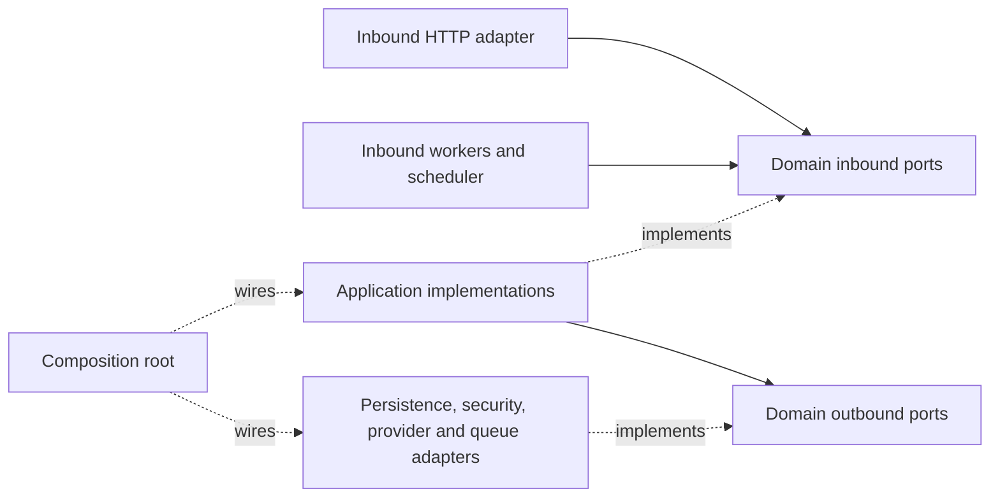

# Automata service architecture

The service uses hexagonal architecture. Each `svc/internal/domain/<context>` package owns its inbound and outbound ports, their signature models, policies and business outcomes. Domain depends only on domain, permitted standard-library packages and UUID values.

Application services implement inbound use cases and orchestrate outbound domain ports. They depend on domain and other application packages. Concrete infrastructure implementations are injected in `svc/internal/composition`; application and domain never import adapters or configuration.

Examples of canonical contracts:

| Context | Inbound use cases | Outbound dependencies |
| --- | --- | --- |
| Auth | `auth.AuthUseCases`, `auth.UsersQueries` | Identity providers, token issuer/verifier, password hasher, user/session/state repositories |
| Accounts | `accounts.AccountUseCases`, `accounts.AccountsQueries` | Account repository, mailbox/provider connectors, Microsoft OAuth, shared token vault |
| Messages | Message use cases, query and submission ports | Message/summary/forward repositories and accounts mailbox ports |
| Jobs | Execution, scheduler, query and request ports | Job store, run/schedule repositories, durable and legacy enqueue ports |
| Projects | Project, assignment, overview, AI and extraction ports | Project/assignment/manual/timeline repositories and AI ports |

HTTP handles request decoding and response mapping. Application query and submission services own scoped lookups, category replacement, schedule persistence, forward-rule workflows, combined reads, cancellation, and inline/durable/legacy job branching. Domain owns validation and normalization policies. SQL absence is translated to `shared.ErrNotFound` while each port retains its existing nil, boolean or idempotent outcome.

The Asynq producer is outbound and task consumption is inbound. Their shared payload under `adapters/shared/asynqtask` preserves the versioned wire format; domain job requests have no Asynq schema fields. Worker and scheduler entrypoints receive domain execution/tick contracts.

[Architecture checks](../../svc/internal/architecture/README.md) enforce direct and transitive dependency direction, domain test isolation, contract ownership, absence of compatibility seams and an empty migration exception manifest. Repository/provider/job-store contract suites and compile-time assertions check implementations. Backend CI enables Postgres and DynamoDB Local and rejects skipped test cases.

[R1–R4 migration evidence](domain-owned-ports-migration-results.json) records fresh Go 1.24.0 test runs. The [RFC](rfc-domain-owned-ports.md) records decisions and phase exits; R0 reports remain historical snapshots. Live Aurora DSQL behavior was not tested by these local gates.
