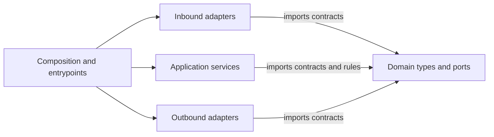

# RFC: Domain-Owned Ports and Service Boundaries

**Status:** R0–R3 complete; R4–R4 proposed

**Related:** [Initial specification §2.4](initial.md#24-backend-project-structure-ddd-hexagonal-ports-and-adapters), [AWS deployment](aws-deployment.md), [Multi-provider mail RFC](rfc-multi-provider-mail.md)

**Last updated:** 2026-10-11

Automata should use a hexagonal architecture in which the domain defines and owns the ports. Application services orchestrate domain behavior through those contracts. Infrastructure implements outbound ports, and HTTP, workers, schedulers, and CLIs invoke inbound use-case ports. The domain must remain independent of every outside layer.

The current service has a useful adapter structure and a clean domain dependency direction, but its contracts belong to the application layer. Authentication imports a security adapter, several HTTP handlers implement use cases, and SQL errors escape persistence. This RFC proposes an incremental refactor that fixes those boundaries while preserving existing behavior.

## 1. Findings and scope

The review covered production code in `svc/internal/domain`, `application`, `adapters`, and `composition`, plus the architecture specification. All ten current domain packages use only standard-library imports. That property should be preserved in spirit: adding domain-owned contracts must not introduce dependencies on outside service layers or infrastructure libraries.

| Finding | Current evidence | Proposed change |
| --- | --- | --- |
| Ports belong to application | [`application/ports/driven`](../../svc/internal/application/ports/driven/persistence.go) contains repositories and shared models; mailbox, OAuth, LLM, session, and job contracts live alongside them | Move contracts and required types to their owning domain contexts |
| Additional contracts sit in services | [`jobs/scheduler.go`](../../svc/internal/application/jobs/scheduler.go) defines `ScheduleCASRepository`, `EffectAuditReconciler`, and `ChainEnqueuer`; overview and project AI define attention interfaces; [`messages/sync.go`](../../svc/internal/application/messages/sync.go) declares inline `Resolve` and `Assign` interfaces | Move all seven contracts as well; do not limit the refactor to the `ports` directory or named interfaces |
| Authentication depends on infrastructure | [`auth/service.go`](../../svc/internal/application/auth/service.go) imports the security adapter and calls JWT signing and bcrypt | Inject domain-owned token and password capabilities |
| HTTP implements use cases | [`http/router.go`](../../svc/internal/adapters/inbound/http/router.go) implements category deletion/reassignment, schedule updates, and other repository operations; [`forward_rules.go`](../../svc/internal/adapters/inbound/http/forward_rules.go) orchestrates rule validation and persistence | Extract application use cases and domain policy; leave request/response translation in HTTP |
| Persistence errors escape the adapter | Auth, facts, and interpretation services inspect `sql.ErrNoRows` | Translate storage errors into documented domain-owned outcomes |
| Specification encodes the old ownership | [Initial specification §2.4](initial.md#24-backend-project-structure-ddd-hexagonal-ports-and-adapters) explicitly places ports under `application/` | Update the normative layout when this RFC is accepted |

This is an architecture refactor. It does not propose changes to HTTP routes, response shapes, mailbox capabilities, authentication policy, database schema, deployment topology, or the durable job protocol. Existing defects discovered during extraction should receive separate behavior changes with explicit tests.

## 2. Proposed dependency rules

| Layer | Responsibility | Allowed dependencies within `internal/` |
| --- | --- | --- |
| `domain` | Business types, invariants, errors, inbound and outbound contracts | Other domain packages with acyclic dependencies |
| `application` | Implement use cases; coordinate authorization, repositories, providers, and domain rules | Domain and other application packages |
| `adapters/inbound` | Decode external input, invoke use-case ports, translate output | Domain contracts and inbound/shared adapter helpers |
| `adapters/outbound` | Implement persistence, identity, mail, AI, and queue capabilities | Domain contracts and outbound/shared adapter helpers |
| `composition` and `cmd` | Construct implementations, configure processes, connect ports to implementations | Any layer needed for wiring |
| `configuration` | Load process configuration and secrets | Infrastructure dependencies needed for configuration; consumed by composition/entrypoints |

Production domain and application code must not import adapters, configuration, composition, SQL packages, HTTP frameworks, provider SDKs, JWT implementations, or password-hashing implementations. Domain imports must also exclude application packages. Infrastructure dependencies must not reappear through a generic helper package or a type alias in domain.

Domain contracts may use `context.Context`, `time.Time`, standard-library errors, and the existing `github.com/google/uuid` identifier type. UUID is an explicit permitted value-type dependency; replacing identifiers is outside this RFC. This permission does not extend to infrastructure SDK types.

Driving and driven ports have different implementations:

- **Inbound use-case ports** are domain-owned interfaces implemented by application services. HTTP, scheduler triggers, workers, and CLIs call them.
- **Outbound capability ports** are domain-owned interfaces implemented by infrastructure adapters. Application services call them.
- **Internal collaboration contracts**, such as attention queries and job executors, are domain-owned interfaces implemented by the relevant application services.

An inbound adapter does not implement the use case it invokes. An application service can implement a port without being infrastructure. Contract ownership and implementation placement are separate decisions.



Arrows above represent source dependencies. At runtime, inbound adapters call application services, which call injected outbound adapters.

## 3. Package and type ownership

Place contracts beside the domain types they use, rather than creating another central package containing every repository. A context can use `models.go`, `ports.go`, and `usecases.go`; these filenames are a convention, not a requirement for one file per interface.

```text
svc/internal/
  domain/
    shared/           # common errors, value types and token-vault capability
    accounts/         # account and mailbox/connect/provider contracts
    auth/             # users, sessions, sign-in, token and password contracts
    connectors/       # connector accounts/bindings/messages and Slack contracts
    messages/         # messages, categories, drafts, forwarding, summaries
    jobs/             # durable job types, store, execution, scheduling contracts
    ai/               # model requests/results, usage and model-client contracts
    attention/        # attention query contracts shared across use cases
    contacts/         # contact models and repository/use-case contracts
    projects/         # project models, assignment and timeline contracts
    facts/            # fact/version/evidence models and contracts
    ...               # remaining existing business contexts
  application/        # use-case implementations; no ports/driven at completion
  adapters/
    inbound/          # HTTP and queue/trigger translation
    outbound/         # database, mailbox, security, AI, job-store implementations
  composition/        # wiring and lifecycle
  configuration/     # process configuration
```

The existing domain contexts remain. The new `auth`, `connectors`, `messages`, `jobs`, `ai`, `attention`, and `shared` packages fill ownership gaps. Mailbox contracts initially live in `accounts` alongside account/connection types so the move does not require circular imports between accounts and messages.

R1 covers all **44 application-owned contracts** recorded in the [R0 inventory](r0-domain-owned-ports-inventory.md#1-application-owned-contracts): 37 in `ports/driven`, five named interfaces elsewhere in application, and two inline interfaces on `SyncService`. Use the inventory's context mapping, with the ownership decisions below; `TokenVault` moves to `shared` rather than its historical candidate `accounts`. Move the required signature type closure alongside each contract, using the inventory of 98 central supporting types to check completeness.

| Contract(s) | Canonical owner and migration decision |
| --- | --- |
| `Mailbox`, `MailProvider`, `OAuthMailConnector`, `PasswordMailConnector` | `domain/accounts`, with their mailbox, connection and capability types |
| `MicrosoftOAuth` and its provider `TokenPair` | `domain/accounts`; sign-in and mail services consume the same contract. Do not duplicate it in auth or make accounts depend on auth to exchange mail tokens |
| `UserRepository`, `AuthSessionRepository`, `OAuthStateRepository`, `GoogleOAuth` | `domain/auth`; account and connector flows reuse the OAuth-state contract through application orchestration |
| `TokenVault` | `domain/shared`; a narrow encryption capability shared by account and connector flows, implemented by an outbound adapter. Keep secrets and encryption configuration outside domain |
| `ConnectorRepository`, `SlackClient` | `domain/connectors`, with connector and Slack request/result types |
| `SyncService.Resolve` | A named contract in `domain/contacts`, retaining `BackfillAccount(context.Context, uuid.UUID, uuid.UUID) error` |
| `SyncService.Assign` | A named contract in `domain/projects`, retaining `AssignAfterSync(context.Context, uuid.UUID, uuid.UUID) error` |
| `AttentionCounts`, `AttentionProjects` | `domain/attention`; application services retain their implementations |
| `ScheduleCASRepository`, `EffectAuditReconciler`, `ChainEnqueuer` | `domain/jobs`, alongside the central job contracts |

The sync hooks remain application collaboration contracts; preserve their optional use and existing queued/inline branches. The Microsoft provider token pair remains distinct from application authentication response types. R2's sign-in identity capability returns domain-owned identity values without requiring provider claims or adapter types in auth contracts.

### 3.1 Move contract types with their interfaces

`AccountRow`, `MessageRow`, `ProjectRow`, `FactRow`, job records, filters, mailbox results, and other types used by port signatures must have domain-owned definitions before their ports move. No domain signature may refer back to application DTOs.

Preserve names and field representations in the first move. Keeping a `Row` suffix temporarily is acceptable: the first milestone changes ownership without also changing every mapping. Subsequently distinguish business models from query projections and adapter-local storage records. Fields such as `FromJSON` and `ValueJSON` should be evaluated separately; their representation changes are not prerequisites for fixing dependency direction.

HTTP request and response DTOs stay in the HTTP adapter. SQL scan structures and provider SDK DTOs stay in their adapters. Domain-owned use-case inputs/results describe the operation and may contain read projections; they must not expose SQL handles, HTTP requests, JWT claims, SDK responses, or adapter types.

### 3.2 Keep context dependencies acyclic

Identify cross-context dependencies before splitting the current central package. Put genuinely shared errors/value types and the explicitly shared `TokenVault` capability in `domain/shared`; do not use it as a destination for unrelated repositories. A repository serving several contexts should have a clear owner and expose projections using domain types.

Move `AttentionCounts` and `AttentionProjects` to `domain/attention`; their application implementation remains the attention service. Job scheduling and execution contracts belong to `domain/jobs`, including the interfaces currently declared in `scheduler.go`. Preserve existing optional capability behavior, including the scheduler's conditional use of `ScheduleCASRepository`, during the relocation.

### 3.3 Transitional compatibility

Temporary aliases in `application/ports/driven` may point **into domain** to let callers migrate in batches. The reverse is prohibited. Each compatibility symbol must map to one canonical domain definition; do not maintain duplicate interfaces or parallel models.

Functions and package variables need deliberate handling because Go type aliases do not cover them. For example, LLM usage scope helpers can move to the AI context with temporary forwarding functions. The old package is removed after its last consumer migrates.

## 4. Authentication boundaries

Add narrow interfaces in `domain/auth`, implemented by outbound security adapters:

| Contract | Operation | Implementation |
| --- | --- | --- |
| `AccessTokenIssuer` | Issue an access token for an authenticated user | Existing JWT signing wrapped in an adapter instance |
| `AccessTokenVerifier` | Verify an access token and return the user identity | Existing JWT parsing wrapped in an adapter instance |
| `PasswordHasher` | Hash a password and verify a stored hash | Existing bcrypt behavior |

Use domain value types and errors in these signatures. Secrets, token TTL, signing algorithm, and bcrypt cost are adapter configuration supplied by composition. Authentication use cases depend on these interfaces and retain registration, identity linking, refresh rotation, and session orchestration.

HTTP authentication middleware receives an `AccessTokenVerifier` rather than importing `adapters/outbound/security`. It still parses the Authorization header and establishes the request identity. Registration/login handlers depend on the authentication use-case port. This removes both the application-to-security import and direct HTTP-to-security coupling.

Preserve signing/verification behavior, claims, expiry, password compatibility, and external identity linking during extraction. Do not introduce algorithm changes or token-format migrations into this refactor. Provider-specific Microsoft claim parsing currently in application auth should move behind the sign-in provider capability, returning the existing subject/email outcome without changing identity selection.

## 5. Use cases behind inbound ports

Define operation-sized interfaces in the owning domain context; do not create a single interface exposing all methods of `http.Handlers`. Start with the behaviors currently embedded in HTTP:

| Area | Application responsibility | Domain policy | HTTP responsibility |
| --- | --- | --- | --- |
| Categories | Create/update/delete; inspect usage; authorize and orchestrate replacement | Slug/name/definition constraints; valid replacement rules | Decode body/query; map result/errors |
| Schedules | Replace the caller's schedules; choose IDs/times; coordinate persistence | Interval defaults/limits and valid schedule chains | Decode chains; map result/errors |
| Forward rules/allowlist | Check ownership, load allowlist, create/update/delete rules | Destination/start-scope/condition validity and normalization | Decode input; render rule and validation errors |
| Summary settings, action items, FYI, draft listings | Invoke repository operations with the caller's scope | Existing validation and lifecycle rules | Translate requests and responses |
| Mail and runs | Authorized message/run queries, cancellation and job requests | Existing job/state constraints | Parse filters, emit paging headers and public run shape |

For example, deleting an in-use category without a replacement currently fails inside the HTTP handler. After extraction, the same call through a domain-owned category use-case port must fail with a typed validation outcome, and HTTP must preserve its existing response.

Inventory every repository field on `http.Handlers` and every direct repository call, not only the examples above. Move orchestration into application services. Handlers eventually hold use-case interfaces, a token verifier, logging, and HTTP configuration rather than repositories, concrete services, or `*asynqadapter.QueueClient`.

Route job requests through a domain-owned contract that can be backed by the durable enqueuer, inline execution, or the transitional Asynq path. Move the Asynq queue producer role to an outbound adapter; task consumption remains inbound. Task names/payload serialization remain adapter-local. Extract existing branches before redesigning them. Worker and scheduler entrypoints also receive domain-owned execution/tick contracts, with composition constructing the concrete services.

Read-only endpoints may use explicit query ports implemented by application query services. This keeps caller scoping and authorization reusable. Wire adapters to application implementations exclusively through composition and entrypoints.

## 6. Persistence outcomes and shared helpers

Introduce `domain/shared.ErrNotFound` for operations whose contract reports absence as an error. SQL adapters translate `sql.ErrNoRows` before returning across the port. Application services translate domain absence into the appropriate business outcome, such as invalid credentials or missing evidence. Storage outages must remain distinguishable from absence.

The [R0 missing-record and idempotency matrix](r0-domain-owned-ports-baseline.md#4-missing-record-and-idempotency-behavior) is a binding R2 compatibility requirement. Preserve each operation's error, nil-result, `ok` boolean, affected-row and successful no-op outcome while replacing SQL-specific errors. In particular, preserve scoped non-disclosure, invalid-credential responses, atomic one-time session/state consumption, idempotent deletes, scheduler CAS fallback, and job-store absence/conflict sentinels. Storage failures must remain distinct from each of those outcomes.

Update SQL-error-returning adapters and their consumers together, with focused contract or behavior checks for each migrated operation. Cover raw scan errors as well as explicit `sql.ErrNoRows` returns; the fourteen methods with explicit sentinel returns are not the entire normalization scope. Remove transitive SQL dependencies from `application/jobs` and `application/reconcile` as their underlying application dependencies change; eliminating direct SQL imports alone does not satisfy R2.

Persistence, mailbox, and job-store contract suites must exercise the domain-owned contracts. Keep raw SQL, migrations, connection lifecycle, and vendor error recognition within adapters.

Some outbound adapters currently import `application/joblistcursor`. Move cursor serialization/signing to a shared outbound adapter helper; keep the job port's cursor opaque to callers and preserve its bytes and scope checks. Review other shared helpers during the dependency inventory: pure domain behavior belongs in domain, orchestration in application, and transport/storage encoding in adapters.

## 7. Migration plan

Implement sequential, independently reviewable changes. Every phase must compile and preserve the relevant behavior tests.

| Phase | Work | Exit criterion |
| --- | --- | --- |
| R0: Baseline and rules | Inventory interfaces, signature types, helper imports, direct HTTP repository calls, and current missing-record behavior; record baseline test results; add dependency checks | Domain isolation is enforced immediately; existing application/adapter violations are explicitly listed so new ones fail CI |
| R1: Domain ownership | Move all 44 inventoried contracts and their required types context by context, including both inline sync hooks; add temporary inward aliases; migrate application, adapter, composition, test-suite and CLI imports | All 44 ownership exceptions and all 13 R1 import exceptions are removed; canonical definitions are domain-owned; domain has no outward imports or cycles |
| R2: Infrastructure seams | Inject JWT/password ports; relocate provider claim mapping; translate SQL errors according to the R0 behavior matrix; move outbound cursor helper | All 10 R2 import exceptions are removed, including transitive SQL paths; production application has no forbidden infrastructure dependencies; security and persistence compatibility checks pass |
| R3: Inbound seams | Extract categories, schedules, forwarding, remaining direct repository flows, and job dispatch; add domain-owned use-case contracts; inject them into HTTP/workers/scheduler | All 18 R3 import exceptions are removed; inbound adapters consume contracts without concrete application service or unrelated adapter dependencies; direct repository orchestration is gone |
| R4: Cleanup and specification | Remove residual compatibility aliases/wrappers; update architecture documentation and contract examples | `application/ports/driven` has no consumers and is deleted; no active migration exceptions remain; CI enforces the final dependency rules |

R1 may be split into context-sized PRs. Each must move all signature dependencies before or with its contracts. R2 and R3 can also be split by capability/use case after the affected domain definitions exist. Avoid mixing schema or product changes into these PRs.

The phase counts come from the [R0 exception manifest](../../svc/internal/architecture/testdata/migration_exceptions.json): 41 import exceptions assigned to R1/R2/R3 as 13/10/18, plus 44 R1 contract-ownership exceptions. Delete each entry in the same change that resolves it; the architecture check rejects stale entries. These are required phase exits, not cleanup deferred to R4. Earlier removal is allowed, but moving debt to a later phase or adding permissions is not. By R3 exit the manifest has no active migration exceptions; R4 removes remaining compatibility code and finishes documentation.

Migration scope includes all service entrypoints, composition, existing tests/fixtures, and CLIs, including development tooling. Composition may aggregate several narrow repository interfaces for wiring; application dependencies should use only the contracts each service needs.

Rollback is a code/deployment rollback to the preceding phase. Existing database records, encrypted credentials, access/refresh tokens, cursors, and in-flight jobs remain compatible. No data backfill or coordinated infrastructure cutover is proposed.

## 8. Validation and acceptance criteria

Retain the [R0 architecture test](../../svc/internal/architecture/README.md) under `svc/internal/architecture`, which inspects Go ASTs and separates production and test imports. Check direct imports against the layer rules and an explicit infrastructure-dependency denylist. Traverse dependencies through Automata-owned packages as well so wrapper packages cannot conceal an outward import. Approved value-type libraries such as UUID are allowed without imposing Automata's layer rules on their private dependency trees; their infrastructure types still must not enter port signatures. Compilation also checks package cycles; behavior tests and review cover semantics and type mappings that the source check cannot prove.

During migration, exceptions must identify a specific originating package/dependency or contract and its removal phase. Domain has no outward exceptions. Apply the phase gates in §7 and do not regenerate the manifest to accept new violations.

Non-domain `_test.go` files may compose multiple layers for integration setup; those imports do not enter the production dependency graph. Domain unit tests stay isolated from application and adapters. Three existing suites use ordinary `.go` files and have explicit test-support rules: `internal/adapters/outbound/jobstoretest`, `internal/adapters/outbound/mailboxtest`, and `internal/adapters/outbound/persistencetest`. Production code must not import these packages, directly or transitively. Other production files follow their layer rules; a name ending in `test` grants no exemption. These permanent test-support rules are distinct from migration exceptions.

Validation combines dependency checks with existing behavior and contract tests:

- Run fresh `go test -count=1 ./...` from `svc/` with the Go toolchain selected by [backend CI](../../.github/workflows/backend-ci.yml) from `svc/go.mod` (currently declaring Go 1.24.0). Record the actual Go version. R0's local Go 1.27.0 results do not establish compatibility with the CI toolchain.
- Require both Postgres and DynamoDB contract suites to execute without skipped integration tests. Set `AUTOMATA_TEST_POSTGRES_DSN` and `AUTOMATA_TEST_DDB_ENDPOINT` against disposable databases. Extend the existing backend test job, which currently provisions Postgres only, with DynamoDB Local and its endpoint before R1 exit. Missing services or skipped contracts fail the phase validation gate.
- Preserve repository, mailbox, memory/DynamoDB job-store, executor idempotency, and scheduler tests. Retain DSQL syntax/lint, DSN and local runtime-helper checks. Report those separately from live Aurora DSQL SQL, IAM, migration and deployment validation; R0 exercised only local checks. If a change affects a DSQL runtime path, identify and execute the affected live checks before claiming runtime compatibility.
- Validate existing stored password hashes, access-token issuance/verification, refresh rotation, and OAuth identity outcomes. Add focused checks where extraction creates an untested boundary.
- Test extracted use cases through their interfaces with in-memory fakes: category usage/replacement, interval normalization, forwarding allowlist/start scope, absence versus storage failure, and user/project authorization.
- Retain HTTP contract coverage for status codes, JSON fields, pagination headers, validation messages, and auth behavior. Keep run-state/null timestamp behavior and cursor compatibility unchanged.
- Continue using existing bounded-query contract assertions so introducing mappings/query services does not add per-item database calls.

Completion requires all of the following:

1. Every external capability and inbound use-case contract has a canonical definition in domain; its signature types also belong to domain or permitted value-type libraries.
2. Domain imports no outside service layer or infrastructure implementation, directly or through other Automata-owned packages.
3. Application consumes domain contracts and does not import adapters, configuration, composition, SQL, or provider/security implementations.
4. Outbound implementations satisfy their ports, with compile-time assertions for concrete implementations and adapter contract coverage where applicable.
5. Inbound adapters call use-case/query contracts; business rules, authorization orchestration, direct repository calls, and concrete application service fields have been removed from them.
6. No SQL-specific errors cross production ports; each operation documents its missing-record outcome.
7. Compatibility packages, duplicate definitions, and migration exceptions are removed.
8. Relevant behavior tests pass with no intended API, persisted-format, or deployment changes.
9. [Initial specification §2.4](initial.md#24-backend-project-structure-ddd-hexagonal-ports-and-adapters) states the new ownership/layout. AWS job and mailbox contract examples reference the new domain definitions; historical implementation records are clearly identified.

These are implementation gates for the complete refactor. R0's inventory, architecture check and baseline validation are recorded in §10; the remaining refactor has not been completed.

## 9. Risks and decisions

| Risk | Mitigation |
| --- | --- |
| Splitting the large persistence package introduces domain import cycles | Map signature dependencies first; colocate contracts with owning types; use narrowly shared values |
| Moving contracts alone leaves behavior coupled to HTTP | Make R3 and its adapter dependency checks required completion criteria |
| Error normalization changes authentication or deletion behavior | Inventory absence semantics per method; update adapters/consumers together; distinguish storage failure in tests |
| Security extraction changes existing tokens/password verification | Preserve adapter algorithms/configuration and exercise compatibility before wiring switches |
| New mappings add query fan-out or change serialized data | Keep representations initially; retain query-count assertions and cursor/job protocol tests |
| A broad refactor makes failures difficult to isolate | Use compiling context/capability-sized PRs, inward compatibility aliases, and phase-specific gates |

A central `domain/ports` package would satisfy physical ownership but retain today's cross-context coupling; this RFC prefers context-owned definitions. Leaving ports under application would preserve the current layout but fail the requested ownership. Moving use-case implementations into domain would blur the separation between policy and orchestration; the proposal keeps implementations in application while domain owns their contracts.

The first migration should preserve existing interfaces and representations where possible. Narrowing oversized repositories, introducing richer entities, changing transaction boundaries, and generalizing identity providers can follow in separate proposals when they have a demonstrated behavior or maintainability benefit.

## 10. R0 execution record

R0 was completed on 2026-10-11. The [baseline report](r0-domain-owned-ports-baseline.md) records working-tree scope, helper seams, absence/idempotency behavior and validation limits. The [source inventory](r0-domain-owned-ports-inventory.md) lists all 44 application-owned contracts, 98 central supporting types, 41 dependency exceptions and 66 direct HTTP dependency calls.

The [architecture check](../../svc/internal/architecture/README.md) enforces domain isolation immediately and tracks exact existing exceptions with removal phases. Full before/after test runs passed with local Postgres and DynamoDB contracts enabled; [package-level evidence](r0-domain-owned-ports-test-results.json) records the results. R1–R4 remain to be implemented.

## 11. Migration execution

R1 relocated all 44 inventoried contracts and their supporting types into the domain contexts in §3. Every caller now imports the owning domain package; inward compatibility aliases remain for R4 cleanup. All 44 ownership and 13 R1 import exceptions were removed. Backend CI now provisions DynamoDB Local and rejects skipped tests alongside its existing Postgres fixture.

Validation used Go 1.24.0 with both local databases enabled; the full fresh suite passed with 489 test cases and no skipped tests. [Phase results](domain-owned-ports-migration-results.json) record validation as subsequent phases complete. Live Aurora DSQL validation remains outside these local checks.

R2 injected domain-owned token, password and Microsoft identity capabilities; moved the cursor codec into outbound adapters; translated SQL absence at every public repository boundary; and removed all ten R2 import exceptions, including transitive SQL paths. Cross-adapter tests enforce the R0 absence matrix, and compatibility tests cover JWTs, bcrypt and Microsoft identity claim selection. Full fresh validation on Go 1.24.0 passed 528 test cases with Postgres and DynamoDB Local enabled and no skips.

R3 introduced domain-owned inbound contracts and signature models, application query and submission workflows, and legacy job orchestration. HTTP handlers translate transport data and call use-case ports. Asynq production and consumption now live in outbound and inbound adapters respectively, sharing only their versioned transport payload. All 18 R3 dependency exceptions were removed. Additional focused checks passed for submission compensation, summary defaults, and HTTP compatibility after the full gate. Full fresh validation on Go 1.24.0 passed 529 test cases with Postgres and DynamoDB Local enabled and no skips.
